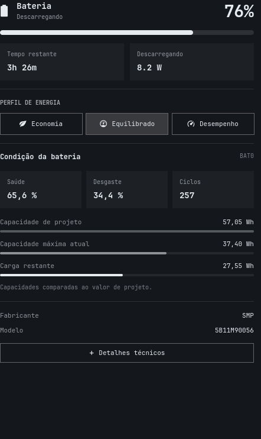

# Omarchy Battery

Painel de bateria para o **Omarchy Shell (Quickshell)**, com identificação do
hardware, saúde, desgaste e capacidades comparáveis. Mantém os perfis de energia
e a porcentagem na barra do painel original.



*A prévia foi renderizada em Qt com o tema escuro e leituras de exemplo. A
aparência acompanha o tema, a fonte e a escala da sua instalação.*

## Recursos

- Resumo de saúde, desgaste e ciclos de carga.
- Tempo real de uso fora da tomada e gráfico de barras de percentual × tempo.
- Registro em segundo plano, descontando a suspensão, com a última sessão salva localmente.
- Capacidade de projeto, capacidade máxima atual e carga restante na mesma escala.
- Fabricante e modelo visíveis no resumo.
- Detalhes técnicos: marca, part number, número de série, tecnologia, tensão,
  potência e temperatura, quando informados pelo driver.
- Múltiplas baterias internas, inclusive drivers que fornecem capacidade em mAh.
- Perfis de energia e opção de mostrar a porcentagem na barra.
- Português e inglês; números seguem o idioma do Omarchy.
- Leitura local de `/sys/class/power_supply`, sem rede e sem privilégios.

## Compatibilidade e dependências

Desenvolvido e validado com **Omarchy 4.5.0-3**, usando o Omarchy Shell/Quickshell.
Não é um módulo Waybar. Versões anteriores que não fornecem as APIs abaixo não
são suportadas; versões futuras podem exigir ajustes por usar componentes do shell.

A instalação precisa de `git`, `jq` e `python3` (somente biblioteca padrão).
O shell precisa oferecer `qs.Ui`, `qs.Commons.Translations`, UPower e estes comandos:

```text
omarchy plugin add / enable / update / remove / validate
omarchy-battery-status
omarchy-powerprofiles-list
omarchy-powerprofiles-set
omarchy-system-stats
```

Em uma instalação Omarchy compatível, os componentes do shell já vêm com o sistema.
Instale eventuais dependências ausentes com:

```bash
omarchy pkg add git jq python
```

## Instalar

Em um terminal da sessão gráfica do Omarchy:

```bash
omarchy plugin add https://github.com/eusener/omarchy-battery.git --enable
```

Selecione a seção `right` se o instalador perguntar onde colocar o widget.
O identificador é **`eusener.power`**, independentemente do seu usuário Linux.
O manifesto declara que ele substitui `omarchy.power`, preservando o roteamento
IPC do painel original. Nenhum arquivo em `/usr/share/omarchy/` é alterado.

Para instalar sem ativar, omita `--enable`. Ative depois com:

```bash
omarchy plugin enable eusener.power --section right
```

O Omarchy recarrega os plugins automaticamente. Se necessário:

```bash
omarchy-shell shell rescanPlugins
```

### Se você já tem a cópia local `eusener.power`

O instalador recusa identificadores duplicados. Guarde suas customizações antes
de migrar. Para a cópia local sem Git, `remove` cria um backup e restaura o painel
original; depois instale a versão gerenciada por Git:

```bash
omarchy plugin remove eusener.power
omarchy plugin add https://github.com/eusener/omarchy-battery.git --enable
```

Se sua cópia já é gerenciada por Git, revise e salve suas alterações antes de
remover: o comando de remoção apaga clones Git após confirmação.

## Usar

| Ação | Controle |
|---|---|
| Abrir ou fechar o painel | Clique no ícone de bateria |
| Alternar porcentagem na barra | Clique direito no ícone |
| Mostrar ou ocultar detalhes técnicos | Botão “Detalhes técnicos” ou tecla **D** |
| Rolar o painel | Roda do mouse, touchpad ou **Page Up / Page Down** |
| Escolher perfil de energia | Clique ou setas e **Enter** |
| Fechar | **Esc** |

O painel consulta os detalhes das baterias ao abrir e a cada cinco segundos
enquanto aberto. Para medir o uso, faz também uma leitura a cada 30 segundos
com o painel fechado e ao detectar mudanças da fonte de energia. Os serviços
originais do Omarchy continuam responsáveis pelo ícone e pelos avisos de bateria fraca.

### Tempo real de uso e gráfico

Ao desconectar o carregador, o plugin inicia uma sessão por bateria interna.
O contador soma o tempo em que o computador fica ligado fora da tomada,
descontando a suspensão. Bloquear a tela ou ficar sem digitar não pausa a
contagem: o computador continua usando a bateria.

O gráfico mostra o **percentual restante na vertical (0–100%)** e o **tempo de
uso acumulado na horizontal**. As barras correspondem a leituras reais; não há
projeção de autonomia. Use “Mostrar leituras do gráfico” para consultar os
valores exibidos. Sessões longas têm as amostras antigas compactadas e exibem
até 24 barras, preservando as leituras inicial e final.

Reconectar o carregador encerra a sessão e mantém o resultado visível. A próxima
desconexão começa um registro novo, substituindo o anterior. O arquivo local
`$XDG_STATE_HOME/omarchy-battery/usage.json` (por padrão,
`~/.local/state/omarchy-battery/usage.json`) guarda somente a sessão atual ou a
última sessão por bateria; não contém número de série e não é enviado à rede.

O registro depende do plugin carregado no shell. Ao ativá-lo já fora da tomada,
o painel informa que a medição começou na primeira leitura disponível. Uma
recarga breve do shell preserva a sessão; reiniciar o computador ou passar mais
de 90 segundos de tempo ligado sem leituras inicia uma medição parcial. Mudanças
de energia durante a suspensão ou com o shell parado podem não ser observadas.
A precisão das transições segue a atualização do UPower e a amostragem de até
30 segundos. O histórico anterior à instalação não pode ser recuperado.

### O que significam as capacidades

| Leitura | Significado |
|---|---|
| Capacidade de projeto | Capacidade nominal informada pelo fabricante |
| Capacidade máxima atual | Capacidade estimada pelo controlador ao carregar totalmente |
| Carga restante | Energia ou carga armazenada neste momento |
| Saúde | Capacidade máxima atual ÷ capacidade de projeto × 100 |
| Desgaste | Máximo entre zero e 100 − saúde |

As barras usam a capacidade de projeto como referência e são limitadas a 100%
visualmente. A saúde numérica pode superar 100% por calibração do controlador.
Drivers com dados de energia usam **Wh**; drivers com dados de carga usam **mAh**,
sem conversão estimada entre as unidades. Temperatura usa °C, tensão usa V e
potência usa W.

“Não informado” significa que o driver não forneceu o campo. Marca e part number
não são deduzidos do modelo ou fabricante. Saúde e desgaste são estimativas do
controlador, não medições independentes. Baterias periféricas marcadas pelo driver
como `scope=Device` são ignoradas. Em máquinas sem bateria, o widget fica oculto.

## Atualizar

```bash
omarchy plugin update eusener.power
```

Salve alterações locais antes de atualizar. O plugin não atualiza o Omarchy nem
instala dependências automaticamente.

## Remover ou voltar ao painel original

```bash
omarchy plugin remove eusener.power
```

O gerenciador nativo restaura `omarchy.power` quando remove a substituição ativa.
Se necessário, ative explicitamente:

```bash
omarchy plugin enable omarchy.power --section right
```

## Diagnóstico

```bash
omarchy version
omarchy plugin list --json
omarchy plugin validate ~/.config/omarchy/plugins/eusener.power
python3 ~/.config/omarchy/plugins/eusener.power/battery.py
```

O último comando mostra as leituras brutas normalizadas. Revise o número de série
antes de compartilhar a saída em uma issue. Se o painel não carregar, confirme a
versão do Omarchy e os comandos listados nas dependências.

## Desenvolvimento e testes

```bash
git clone https://github.com/eusener/omarchy-battery.git
cd omarchy-battery
bash scripts/check.sh
```

O script roda os testes de telemetria e verifica manifesto e catálogos. Se
instalados, também executa o validador nativo e o parser `qmlformat`. A CI roda
os testes Python e as verificações estáticas; a integração com o desktop precisa
ser conferida em uma sessão Omarchy.

A raiz do repositório é o próprio pacote do plugin: `manifest.json`, `Panel.qml`,
`Model.js`, `battery.py` e `i18n/`. Não há build, bibliotecas Python externas ou
instalador que edite sua configuração diretamente. Consulte [CONTRIBUTING.md](CONTRIBUTING.md)
e [DESIGN.md](DESIGN.md) para contribuir.

## Licença e créditos

MIT. Derivado do painel `omarchy.power` do
[Omarchy](https://github.com/omacom/omarchy), de David Heinemeier Hansson.
Os avisos de copyright são preservados em [LICENSE](LICENSE).
